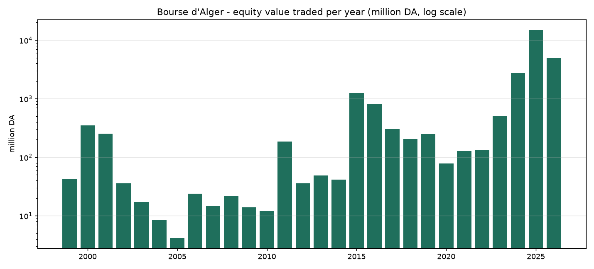
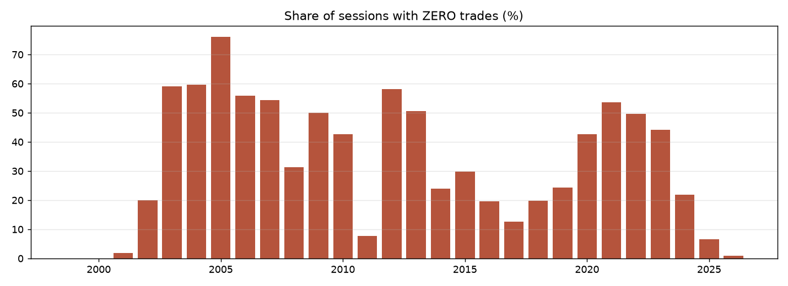
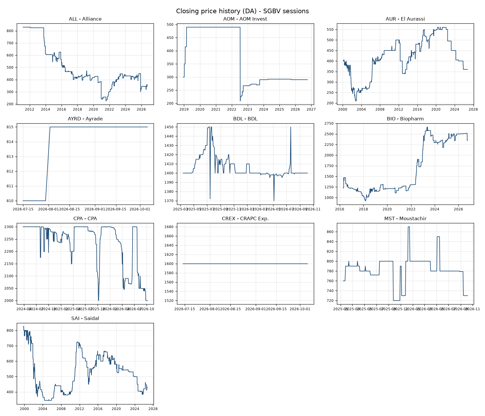
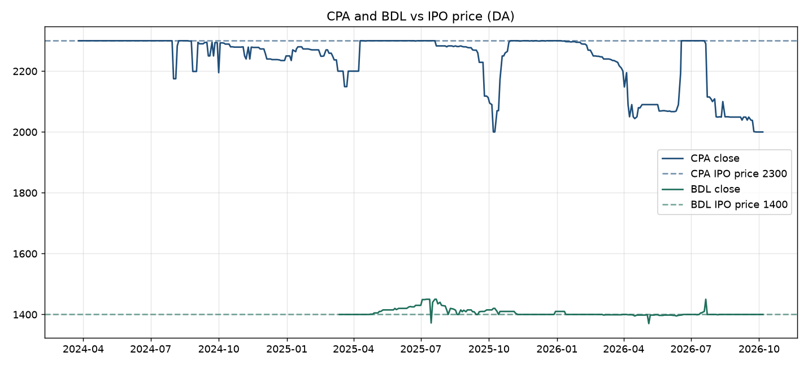

# 05 — الإحصاءات والأداء (من قاعدة بياناتنا 1999–2026)

> **المصدر:** جمعنا **كل الحصص الـ 3,049 للسوق الرئيسية** (من 13/09/1999 إلى 06/10/2026) و1,284 صفحة لسوق PME من موقع sgbv.dz ✅. البيانات الكاملة في `data/`. التحليل = `scripts/analyze.py` 🔎.
> ⚠️ الأسعار **غير معدّلة** للمنح والتجزئة والتوزيعات. حين يكون الحجم = 0 فالسعر هو سعر المرجع وليس صفقة.
> آخر تحديث 6 أكتوبر 2026

## 1. النشاط السنوي (الأسهم، السوق الرئيسية)
| السنة | الحصص | قيمة التداول (مليون دج) | عدد الصفقات | حصص بلا صفقة | ٪ بلا صفقة | متوسط/حصة (مليون دج) |
|---|---|---|---|---|---|---|
| 1999 | 16 | 43.0 | 1,047 | 0 | 0% | 2.69 |
| 2000 | 52 | 350.9 | 4,420 | 0 | 0% | 6.75 |
| 2001 | 53 | 251.8 | 2,771 | 1 | 1.9% | 4.75 |
| 2002 | 90 | 35.9 | 2,042 | 18 | 20% | 0.40 |
| 2003 | 105 | 17.3 | 393 | 62 | 59% | 0.16 |
| 2004 | 104 | 8.4 | 141 | 62 | 60% | 0.08 |
| 2005 | 104 | **4.2** | 64 | 79 | **76%** | 0.04 |
| 2006 | 104 | 23.8 | 144 | 58 | 56% | 0.23 |
| 2007 | 105 | 14.5 | 113 | 57 | 54% | 0.14 |
| 2008 | 102 | 21.4 | 203 | 32 | 31% | 0.21 |
| 2009 | 104 | 13.9 | 160 | 52 | 50% | 0.13 |
| 2010 | 103 | 12.0 | 125 | 44 | 43% | 0.12 |
| 2011 | 102 | 185.1 | 413 | 8 | 8% | 1.81 |
| 2012 | 105 | 36.0 | 143 | 61 | 58% | 0.34 |
| 2013 | 103 | 49.1 | 133 | 52 | 51% | 0.48 |
| 2014 | 104 | 41.4 | 251 | 25 | 24% | 0.40 |
| 2015 | 104 | 1,252.0 | 259 | 31 | 30% | 12.04 |
| 2016 | 102 | 805.5 | 339 | 20 | 20% | 7.90 |
| 2017 | 103 | 302.3 | 438 | 13 | 13% | 2.93 |
| 2018 | 116 | 205.8 | 440 | 23 | 20% | 1.77 |
| 2019 | 152 | 248.9 | 434 | 37 | 24% | 1.64 |
| 2020 | 129 | 78.5 | 179 | 55 | 43% | 0.61 |
| 2021 | 153 | 127.9 | 219 | 82 | 54% | 0.84 |
| 2022 | 155 | 132.0 | 203 | 77 | 50% | 0.85 |
| 2023 | 154 | 503.2 | 277 | 68 | 44% | 3.27 |
| 2024 | 155 | 2,755.2 | 1,249 | 34 | 22% | 17.78 |
| **2025** | 154 | **14,950.5** | **6,476** | 10 | **6.5%** | **97.08** |
| 2026 (حتى 06/10) | 116 | 4,950.1 | 4,021 | 1 | 0.9% | 42.67 |

### ماذا نستنتج 🔎
- **سنة 2025 وحدها (14.95 مليار دج) = 3 أضعاف كل ما تداولته البورصة من 1999 إلى 2023 مجتمعة (4.76 مليار دج).** السبب: إدراج CPA (2024) وBDL (2025).
- **من 2002 إلى 2023 كان متوسط 40% من الحصص بلا أي صفقة** (1,017 حصة من 2,624 بين 1999 و2023). في 2005 بلغت النسبة 76%.
- السيولة تحسّنت جذرياً: 6.5% فقط من حصص 2025 بلا صفقات، و0.9% في 2026.
- **لكن 2026 أضعف من 2025:** متوسط 42.7 مليون دج للحصة مقابل 97 مليون (−56%). الوسيط هو 24.5 صفقة في الحصة ✅ (يطابق تقرير COSOB: −39% في القيمة في النصف الأول 2026).
- القفزات القديمة (2015: 1.25 مليار، 2016: 0.8 مليار) كانت **صفقات كتل** لا نشاط أفراد: حصة 29/06/2015 وحدها = 1.19 مليار دج **بـ 5 صفقات فقط**.

## 2. تركّز التداول (٪ من قيمة التداول السنوية)
| السنة | CPA | BDL | بيوفارم | أليانس | صيدال | الأوراسي |
|---|---|---|---|---|---|---|
| 2016 | — | — | 81.8% | 14.0% | 1.4% | 0.2% |
| 2019 | — | — | 86.7% | 4.0% | 3.5% | 3.9% |
| 2023 | — | — | 23.5% | 75.2% | 0.0% | 0.2% |
| 2025 | 63.8% | 23.3% | 11.9% | 0.7% | 0.1% | 0.0% |
| 2026 | 43.0% | 50.5% | 2.2% | 3.9% | 0.1% | 0.0% |
🔎 في كل حقبة، **سهم أو سهمان فقط** يصنعان السوق؛ الباقي شبه ميت.

## 3. كل سهم عبر تاريخه
| الرمز | أول حصة | أول سعر | آخر سعر | التغير | أعلى (تاريخ) | أدنى (تاريخ) | ٪ حصص فيها تداول |
|---|---|---|---|---|---|---|---|
| ERD رياض سطيف (مشطوب) | 1999-09-13 | 2340 | 160 (2006) | ⚠️ غير معدّل | 2350 (2000) | 160 (2006) | 27% |
| SAI صيدال | 1999-09-20 | 825 | 431 | **−48%** | 825 (1999) | 345 (2004) | 24% |
| AUR الأوراسي | 2000-02-14 | 400 | 360 | −10% | 561 (2020) | 210 (2002) | 23% |
| ALL أليانس | 2011-03-07 | 830 | 355 | −57% خام (~−36% معدّل للمنحة) | 830 (2011) | 225 (2021) | 29% |
| ROUI NCA رويبة (مشطوب) | 2013-06-03 | 400 | 200 (2020) | −50% | 420 (2014) | 200 (2020) | 23% |
| BIO بيوفارم | 2016-04-20 | 1225 | 2350 | **+92%** | 2665 (2023) | 925 (2018) | 37% |
| CPA | 2024-03-26 | 2300 | 2000 | −13% | 2300 | 2000 (2025-10 و2026-10) | **84%** |
| BDL | 2025-03-13 | 1400 | 1400 | 0% | 1450 (2025-07) | 1370 (2026-05) | **85%** |
| AYRD | 2026-07-15 | 810 | 815 | +0.6% | 815 | 810 | 36% |
| AOM (PME) | 2018-12-12 | 300 | 290 | −3% | 490 (2019) | 209 (2022) | **1.6%** |
| MST (PME) | 2025-01-14 | 760 | 730 | −4% | 870 (2025-12) | 720 (2025-09) | 25% |
| CREX (PME) | 2026-07-14 | 1600 | 1600 | 0% | — | — | **0% (لا صفقة واحدة)** |

### آخر 12 شهراً (من 06/10/2025): عدد الحصص التي حدث فيها تداول من 153
CPA **145** · BDL **127** · أليانس 84 · بيوفارم 46 · مستشير 31 · صيدال 29 · AYRADE 13 (من 36) · الأوراسي **6** · AOM **1** · CREX **0** (من 37).

## 4. CPA وBDL مقارنة بسعر الطرح

🔎 **CPA** التصق بـ 2300 (عقد السيولة) ثم صار ينزل بعد كل موجة بيع، وعاد إلى 2300 قبيل التوزيع ثم سقط بعد فصل الكوبون (−175) ولم يتعافَ. **BDL** ثابت حول 1400 بتذبذب ±3% فقط.

## 5. خلاصات رقمية للمستثمر 🔎
1. **احتمال أن يكون السهم أعلى من سعر طرحه بعد سنوات = ضعيف:** 1 من 8 أسهم (بيوفارم).
2. **الأسهم الصغيرة لا يمكن بيعها:** AOM تداول في 1.6% من حصصه منذ 2018؛ CREX لم يتداول أبداً.
3. **أي سهم خارج CPA وBDL قد يحتاج أسابيع لتنفيذ أمر متوسط الحجم.**
4. **مقاومة الأسعار للصعود قوية:** حتى في أفضل سنة للبورصة (2025) بقيت CPA وBDL قرب سعر الطرح.
